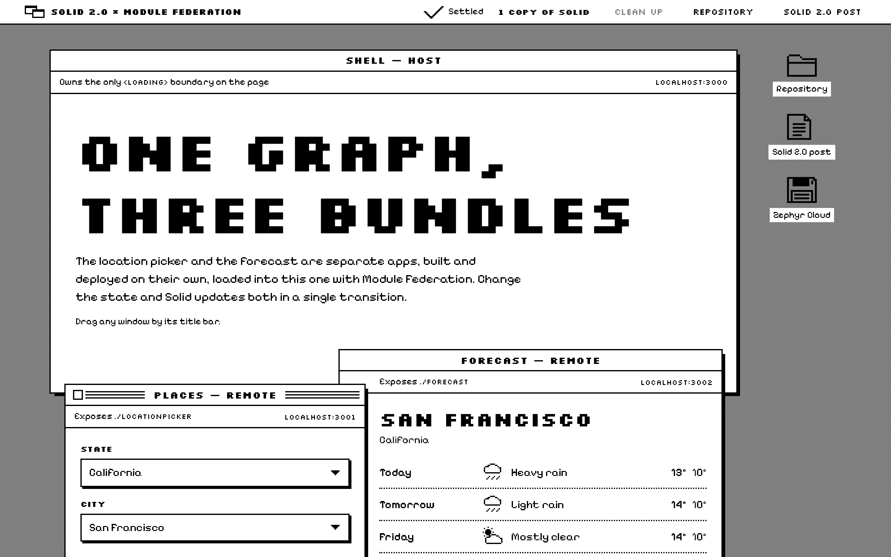
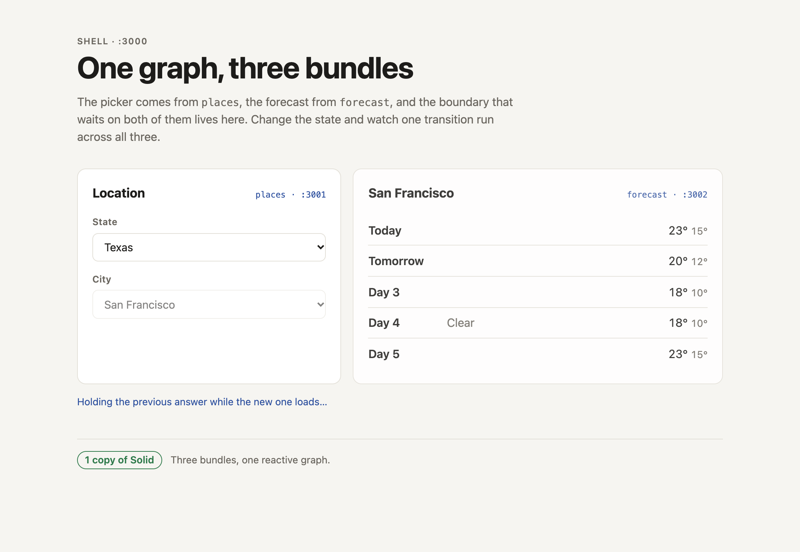

# Solid 2.0 × Module Federation

Solid 2.0's async reactive graph running across three independently built Module Federation bundles.



The demo is the cascading dropdown from the [Solid 2.0 announcement](https://www.solidjs.com/blog/solid-2-0-the-long-hold/), split across three Rsbuild apps wired together with Module Federation:

| App | Port | Role | What it owns |
| --- | --- | --- | --- |
| `shell` | 3000 | host | The page, the only `<Loading>` boundary, the context provider |
| `places` | 3001 | remote | `./location` (async memos, writable derived signals, a context) and `./LocationPicker` |
| `forecast` | 3002 | remote | `./Forecast`, which turns plain `city` and `state` props into an async memo |

Pick a new state and three things happen in three bundles: `places` fetches that state's cities, the derived city resets, and `forecast` fetches the new city's forecast. Solid treats all of it as one transition. The old screen stays up until every piece has an answer, then it all updates at once. `forecast` has no loading state of its own; the boundary that waits on it lives in the shell.



The page is drawn as a one-bit desktop: each bundle is its own window, titled with its name and the host it actually loaded from. During a change both remote windows dim under a dither with marching ants and update together; the menu bar shows the hold and how many copies of Solid are running (in production, read from Module Federation's share record). The design system is recorded in [`DESIGN.md`](DESIGN.md) and the product context in [`PRODUCT.md`](PRODUCT.md).

## Run it

```bash
pnpm install
pnpm dev          # shell on :3000, places on :3001, forecast on :3002
```

Open http://localhost:3000. Each remote also runs standalone on its own port.

```bash
pnpm typecheck
```

## Deploy

Live: https://t-web-latest-nestor-lopez-shell-solid2-module-federat-16ddf9-ze.zephyrcloud.app/ (Zephyr's latest tag, which follows each deploy)

Each app deploys to [Zephyr Cloud](https://zephyr-cloud.io) through `zephyr-rsbuild-plugin`, which runs on `rsbuild build` only, so `pnpm dev` stays local.

```bash
pnpm build                         # deploys places, then forecast, then shell
ZE_DISABLED=true pnpm build && pnpm preview   # local production build, no deploy
```

The remotes build first. The shell's `zephyr:dependencies` (`places` and `forecast`, both `workspace:*`) tells Zephyr to replace the `localhost` remote URLs in its config with the remotes' published versions at build time.

## The shared config

Each app's `rsbuild.config.ts` ([shell](apps/shell/rsbuild.config.ts), [places](apps/places/rsbuild.config.ts), [forecast](apps/forecast/rsbuild.config.ts)) declares the same `shared` block:

```ts
shared: {
  'solid-js': { singleton: true, requiredVersion: '^2.0.0' },
  '@solidjs/web': { singleton: true, requiredVersion: '^2.0.0' },
  '@solidjs/signals': { singleton: true, requiredVersion: '^2.0.0' },
},
```

Solid 2.0 keeps its scheduler, owner tree and transition state in `@solidjs/signals`, so every bundle has to share that one copy for async, context and transitions to work across them. List it by name: `solid-js/internal`, which `@solidjs/web` imports, isn't covered by the `'solid-js'` key and pulls in `@solidjs/signals` directly.

The footer of the shell reads Solid's development-only copy counter (`globalThis.Solid$$copies`) and shows "1 copy of Solid" when the config is right.

Two other details:

- The remotes set `output.assetPrefix: 'auto'` (and the same for `dev`). Without it their manifests say `publicPath: "/"`, and the shell requests the remotes' chunks from its own origin.
- Remote types are hand-written in [`apps/shell/src/remotes.d.ts`](apps/shell/src/remotes.d.ts) using type-only `import()`s. Don't swap these for tsconfig `paths`: Rsbuild honors `paths` as aliases, so the shell would quietly bundle the remotes' source instead of loading them through federation.

## Stack

`solid-js@2.0.0`, `@solidjs/web@2.0.0`, `@rsbuild/core@2.3`, `@rsbuild/plugin-solid@2.0.0`, `@module-federation/rsbuild-plugin@2.9`.

## Data

Everything is live, from public APIs that need no key and allow browser requests:

- `places` lists US states and their cities from [CountriesNow](https://countriesnow.space/).
- `forecast` looks the city up with the [Open-Meteo geocoding API](https://open-meteo.com/en/docs/geocoding-api), filtered to the selected state because names repeat across states, then fetches a 5-day forecast from [Open-Meteo](https://open-meteo.com/).

Some CountriesNow entries are counties the geocoder can't place. `forecast` shows that inside its own `<Errored>` boundary and recovers when you pick another city. If an API is down entirely, the shell's `<Errored>` boundary offers a retry.
